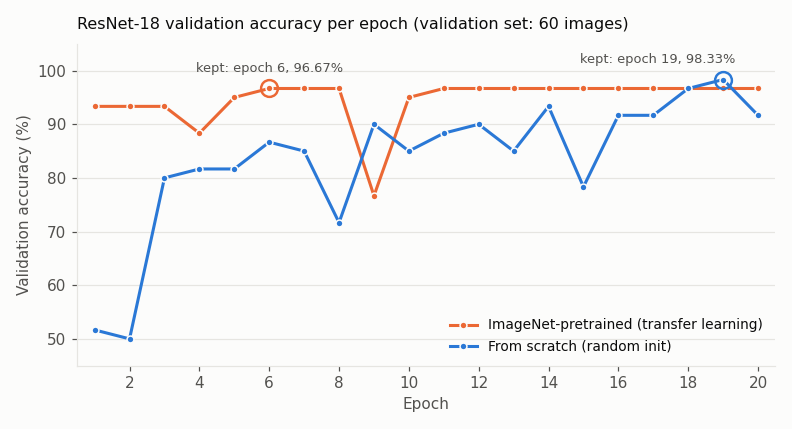
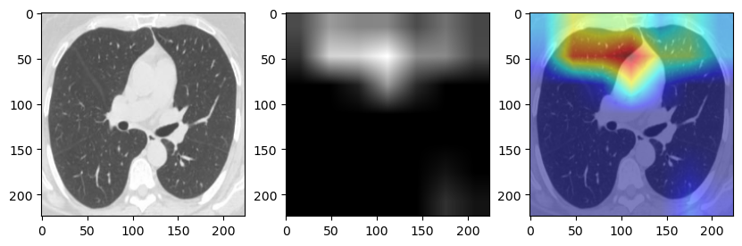

# COVID-19 diagnosis from lung CT slices with ResNet-18

I trained a ResNet-18 to classify 2D lung CT slices as COVID-19 or non-COVID, comparing
training from random initialisation against transfer learning from ImageNet weights, and
then used class activation maps (Grad-CAM and EigenGradCAM) to inspect which regions drove
the predictions. On a held-out test set of 400 slices the from-scratch model reached
**93.0%** accuracy and the ImageNet-pretrained model **97.5%** (single run each).

This was a homework assignment (Homework 5, Task 1) for CSC 546 *Introduction to Machine
Learning with Applications* at the University of Miami, completed in 2023. The instructor
provided the image set, the train/val/test split and the `Dataset` class. The model setup,
training and evaluation loops, and CAM analysis are my own. Everything is in one notebook:
[`result.ipynb`](result.ipynb).

## Dataset

`COVID19CTS/` contains 2,482 grayscale PNG CT slices, all 224 × 224:

| Class | Folder | Label | Images |
|---|---|---|---|
| COVID-19 | `COVID/` | 1 | 1,252 |
| Non-COVID | `NORMAL/` | 0 | 1,230 |

The class counts and file names (`Covid (n).png`, `Non-Covid (n).png`) match the public
**SARS-CoV-2 CT-scan dataset** by Soares et al. This copy came from the course, which did
not state its source, so it *appears to be* that dataset, resized to 224 × 224:

- Kaggle: <https://www.kaggle.com/datasets/plameneduardo/sarscov2-ctscan-dataset>
- Paper: E. Soares, P. Angelov, S. Biaso, M. Higa Froes, D. Kanda Abe. *SARS-CoV-2 CT-scan
  dataset: A large dataset of real patients CT scans for SARS-CoV-2 identification.*
  medRxiv, 2020. doi:[10.1101/2020.04.24.20078584](https://doi.org/10.1101/2020.04.24.20078584)

All credit for the images goes to the dataset authors. See the Kaggle page for the
licence and terms of use. This repository does not grant any additional rights.

The split is defined by the CSV files (`filename,label`). The three splits share no files,
and together they cover every image:

| Split | File | Images | COVID | Non-COVID |
|---|---|---|---|---|
| Train | `train.csv` | 2,022 | 1,022 | 1,000 |
| Validation | `val.csv` | 60 | 30 | 30 |
| Test | `test.csv` | 400 | 200 | 200 |

## Approach

- **Input:** each slice is loaded with scikit-image, scaled to float in [0, 1] and repeated
  to 3 channels (3 × 224 × 224). There is no data augmentation and no ImageNet mean/std
  normalisation.
- **Model:** `torchvision.models.resnet18` with the final layer replaced by a 2-way linear
  layer (11,177,538 parameters, all trainable).
  1. *From scratch:* `weights=None`.
  2. *Transfer learning:* `weights=ResNet18_Weights.DEFAULT` (ImageNet). The full network
     is fine-tuned, with no frozen layers.
- **Training (same for both):** cross-entropy loss, Adam (lr = 1e-4), batch size 32,
  20 epochs, `torch.manual_seed(1234)`, single CUDA GPU.
- **Model selection:** after each epoch I measured accuracy on the **validation** set
  (60 images) and kept the weights from the best epoch. Those weights are then evaluated
  once on the test set.

## Results

| Model | Init | Best val. acc. (epoch) | Test acc. (n = 400) |
|---|---|---|---|
| ResNet-18 | random (from scratch) | 98.33% (19) | **93.0%** (372 / 400) |
| ResNet-18 | ImageNet (transfer learning) | 96.67% (6) | **97.5%** (390 / 400) |



The curves show per-epoch **validation** accuracy, taken from the notebook's printed output.
They are not training accuracy. The pretrained model reaches 93.33% after the first epoch,
dips to 76.67% at epoch 9 and stays at 96.67% from epoch 11 onward. The from-scratch model
starts near chance (50% at epoch 2) and fluctuates more. A single validation image is worth 1.67 percentage points, so small
differences in the curves are not meaningful.

## Model interpretation (Grad-CAM)

I used [jacobgil/pytorch-grad-cam](https://github.com/jacobgil/pytorch-grad-cam) on the
last residual block (`model.layer4[-1]`) of the **transfer-learning** model, targeting the
COVID class (index 1). The example below is a non-COVID slice from the test set
(`NORMAL/Non-Covid (222).png`). The panels show the input, the Grad-CAM map and the overlay:



For this slice, the Grad-CAM map for the COVID class highlights the upper central part of
the image. The EigenGradCAM map, which is also in the notebook, highlights a different
region in the lower left of the image. The notebook does not print the model's prediction
for this slice. The maps varied a lot from image to
image. They are qualitative and based on one example, so they do not show that the model
relies on clinically relevant features.

## How to run

```bash
pip install -r requirements.txt
jupyter notebook result.ipynb
```

- Run from the repository root. The notebook reads `COVID19CTS/*.csv` with relative paths.
- Training cells use `device = "cuda:0"` and need an NVIDIA GPU. To run on CPU, change
  that line (training will be slow).
- The original run used Python 3.10.11 (from the notebook metadata). Package versions were
  not recorded, so `requirements.txt` is unpinned.
- The CAM cells pass `use_cuda=False` to `GradCAM`/`EigenGradCAM`. Not every `grad-cam`
  release accepts this argument. If you get a `TypeError`, remove it.

## Limitations

- **Small evaluation sets:** the test set has 400 images, so one image is 0.25 percentage
  points. The validation set used for checkpoint selection has only 60 images, which makes
  the best-epoch choice noisy and the best validation accuracy optimistic.
- **Single split, single run:** there is no cross-validation, no repeated seeds and no
  confidence intervals. Results are not exactly reproducible even with the fixed seed,
  because cuDNN is not set to deterministic mode. An earlier run of the same notebook (in my course files,
  not in this repo) reached 91.25% from scratch and 96.75% with transfer learning. The gap
  between the two models is in the same direction, but the exact numbers should not be
  over-read.
- **Possible patient-level leakage:** the CSVs list only file names and labels, with no
  patient identifiers. I cannot verify that slices from the same patient are confined to a
  single split. If they are not, the test accuracy is optimistic.
- **Accuracy only:** I did not compute sensitivity, specificity, ROC-AUC or a confusion
  matrix. For a screening task, these metrics would matter more than accuracy.
- **No external validation:** the model was trained and tested on a single source of CT
  slices, so these numbers say nothing about other scanners or hospitals.

## Disclaimer

This is a coursework project for learning purposes. It is **not a medical device**, has not
been clinically validated and must not be used for diagnosis or any clinical decision.
